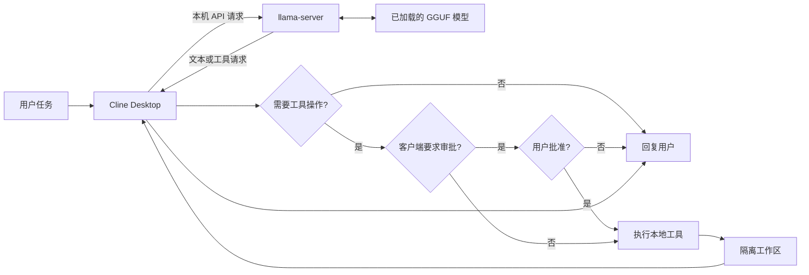

# Local AI Engineering

两个相互衔接的个人项目：先用 llama.cpp 在 Windows 上部署本地模型，再将模型接入 Cline Desktop，搭建本地 Agent 工作流。下表可直接进入各项目的说明与证据。

**个人贡献与 AI 辅助披露：** [查看个人参与工作、第三方依赖与证据边界](docs/contributions.md)。公开的复现脚本、历史启动器与 Codex 协助整理的内容分别说明，不将工具能力或未通过的实验表述为个人原创成果。

| 项目 | 一眼看懂 | 直接入口 |
| --- | --- | --- |
| **01 · 开源模型本地部署与推理环境配置** | Qwen 与 Cosmos 模型加载、本机 API、量化和上下文配置 | **[查看项目一](docs/model-deployment.md)** · [测试与证据](tests/model-test-report.md) |
| **02 · 本地 AI Agent 工作流搭建与应用** | Cline 接入本机模型，观察对话、工具调用与文件工作流 | **[查看项目二](docs/agent-workflow.md)** · [逐项验证记录](tests/agent-acceptance-report.md) |

## 01 · 开源模型本地部署与推理环境配置

使用 llama.cpp 在 Windows 与 NVIDIA GPU 设备上运行 Qwen IQ2_M 和 Cosmos-Reason2-8B，并通过本机 OpenAI 兼容接口调用。原始 `start.bat` 的复测覆盖模型切换、短答、近 16K 索引检索、顺序请求与 Cosmos 图片输入。16,384-token 边界请求虽然答对，但服务日志标记了截断；这些结果不代表无截断长上下文或长期稳定性。

**从这里看证据：** [部署与技术说明](docs/model-deployment.md) → [简历主张与证据](docs/evidence-matrix.md) → [测试报告](tests/model-test-report.md)

展开项目一的脚本、原始结果和排查记录

- [原始启动器审计](docs/launcher-audit.md) · [安全复现示例](scripts/llama-oneclick.example.ps1)
- [本机 API 结果摘录](tests/evidence/local-api-2026-10-21.md) · [原始启动器端到端复测](tests/evidence/start-bat-e2e-2026-10-21.md)
- [Cosmos 图片输入核验](docs/cosmos-multimodal-audit.md) · [历史会话证据摘要](tests/evidence/llama-export-audit-2026-10-21.md)
- [问题记录](docs/model-troubleshooting.md) · [模型来源与许可](docs/sources.md)

## 02 · 本地 AI Agent 工作流搭建与应用

将 Cline Desktop 连接到本机 llama.cpp 的 OpenAI 兼容接口，梳理用户任务、模型响应与本地工具的交互。现有记录覆盖服务连通、模型 ID、两轮 Cline 短对话、文件读取和编辑工具调用；历史计算器样例的五项单元测试也已独立重跑。文件内容精度、审批记录和更长任务的验证进度见下表。

**从这里看证据：** [架构、配置与故障排查](docs/agent-workflow.md) → [逐项验收与复现步骤](tests/agent-acceptance-report.md)

### 架构与流程

模型在服务启动阶段加载；是否执行工具、是否需要人工审批取决于任务与客户端设置。Git 操作不是默认步骤。图示只解释可能的链路，实际执行与验收状态以[报告](tests/agent-acceptance-report.md)为准。

| 验证范围 | 当前记录 |
| --- | --- |
| 服务、模型列表、Cline 短对话（01–03） | 已按记录核对 |
| 文件创建与精确修改（04–05） | Cline 可创建和修改目标文件，但最新隔离复测仍缺末尾 LF；[P0 字节验证与受限修复记录](tests/evidence/agent-p0-recheck-2026-10-22.md)。原生工具精确验收仍需修正 |
| 终端人工审批（06） | 有命令与执行截图；审批动作和原始工具输出待补证 |
| 多文件、Git、整理、恢复与安全检查（07–11） | 本轮按用户安排留待后续验证 |

后续复验计划不改变上表状态；只有取得新的工具记录和独立核对结果，才更新相应结论。

## 阅读与复现

先读对应项目说明，再查看测试报告中的时间、步骤、输出和限制。历史截图、静态文件检查与本轮端到端结果分别标注；配置参数和示意图不等于运行成功。示例只使用本机 `127.0.0.1` 接口；仓库不分发模型权重、运行器、密钥或私人日志。
