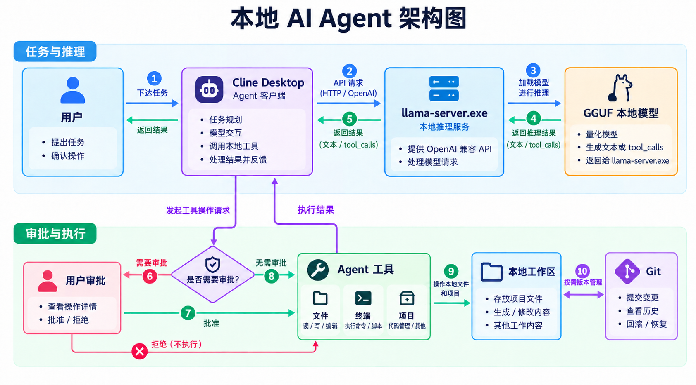
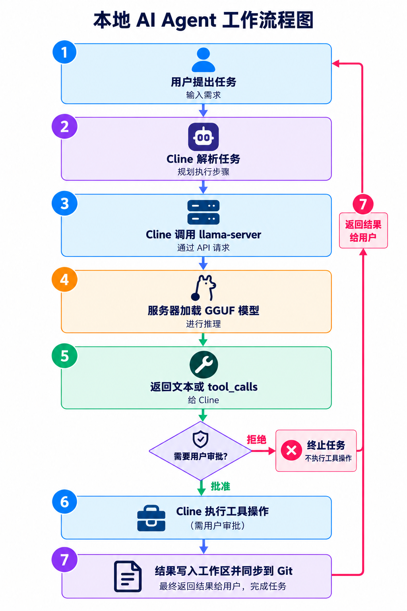

# Local AI Engineering

在 Windows 上搭建并验证本地 AI 推理环境，再将它接入 Cline Desktop，探索 Agent 的文件、终端与代码工作流。本仓库对应两段个人项目经历；每项结论都链接到测试记录，并注明未验证的边界。

| 项目 | 关注点 | 直接入口 |
| --- | --- | --- |
| **01 · 开源模型本地部署与推理环境配置** | llama.cpp、GGUF 模型、启动配置、本机 API 和推理测试 | [部署说明](docs/model-deployment.md) · [测试结果](tests/model-test-report.md) |
| **02 · 本地 AI Agent 工作流搭建与应用** | Cline Desktop 接入本机模型、工具调用、文件操作及故障排查 | [工作流说明](docs/agent-workflow.md) · [11 项验收状态](tests/agent-acceptance-report.md) |

## 01 · 开源模型本地部署与推理环境配置

使用 llama.cpp 在 Windows 与 NVIDIA GPU 设备上运行 Qwen IQ2_M 和 Cosmos-Reason2-8B，并通过本机 OpenAI 兼容接口调用。原始 `start.bat` 的复测覆盖模型切换、短答、近 16K 索引检索、顺序请求与 Cosmos 图片输入。16,384-token 边界请求虽然答对，但服务日志标记了截断；这些结果不代表无截断长上下文或长期稳定性。

**从这里看证据：** [部署与技术说明](docs/model-deployment.md) → [简历主张与证据](docs/evidence-matrix.md) → [测试报告](tests/model-test-report.md)

展开项目一的脚本、原始结果和排查记录

- [原始启动器审计](docs/launcher-audit.md) · [安全复现示例](scripts/llama-oneclick.example.ps1)
- [本机 API 结果摘录](tests/evidence/local-api-2026-10-21.md) · [原始启动器端到端复测](tests/evidence/start-bat-e2e-2026-10-21.md)
- [Cosmos 图片输入核验](docs/cosmos-multimodal-audit.md) · [历史会话证据摘要](tests/evidence/llama-export-audit-2026-10-21.md)
- [问题记录](docs/model-troubleshooting.md) · [模型来源与许可](docs/sources.md)

## 02 · 本地 AI Agent 工作流搭建与应用

将 Cline Desktop 连接到本机 llama.cpp 的 OpenAI 兼容接口，区分模型生成的 `tool_calls`、Cline 发起的工具调用、人工审批和实际文件产物。项目记录了可重现的配置步骤，也如实保留文件路径、引号与上下文超限等失败案例。

**从这里看证据：** [架构、配置与故障排查](docs/agent-workflow.md) → [逐项验收与复现步骤](tests/agent-acceptance-report.md)

### 架构与流程

展开本地 AI Agent 工作流程图

> 两张图是架构与可能流程的示意。图中的 Git 提交／恢复、工具执行和用户审批并非每次任务都会发生，也不表示 11 项已全部通过；实际模型 ID、工具调用和验收状态以[报告](tests/agent-acceptance-report.md)为准。

| 本轮验收 | 实际结果 |
| --- | --- |
| 服务、模型列表、Cline 短对话（01–03） | 通过 |
| 创建文件与精确修改（04–05） | 未通过；保留错误与产物记录 |
| 终端人工审批（06） | 有命令与执行截图，审批动作和原始工具输出证据不完整 |
| 多文件、Git、整理、恢复与安全检查（07–11） | 按用户要求跳过本轮复验 |

## 阅读与复现

先读对应项目说明，再查看测试报告中的时间、步骤、输出和限制。历史截图、静态文件检查与本轮端到端结果分别标注；配置参数和示意图不等于运行成功。示例只使用本机 `127.0.0.1` 接口；仓库不分发模型权重、运行器、密钥或私人日志。
