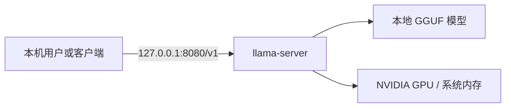

# 开源模型本地部署与推理环境配置

> 2026-10-21 本机核验。仅涵盖 Qwen IQ2_M 与 Cosmos-Reason2-8B；历史截图、独立 CPU 测试与原始启动器复测分开标注。

## 目标与个人工作

项目目标是在 Windows 机器上用 llama.cpp 运行本地 GGUF 模型，控制量化、上下文与输出参数，并提供仅绑定本机的 OpenAI 兼容接口。本机已有多模型启动器和配置文件。用户提供的对话与运行截图支持其参与脚本设计和曾运行启动器的历史记录，但截图没有编辑器身份或代码差异，具体代码贡献仍待补证。本次新增的复现脚本和 API 测试由 Codex 整理，不归入原始开发历史。

简历涉及的四项主张及核验状态见[证据对应表](evidence-matrix.md)。

## 环境与架构

2026-10-21 本机只读检查识别到 Intel i9-14900HX、NVIDIA GeForce RTX 4060 Laptop GPU（`nvidia-smi` 报告 8188 MiB，驱动 617.42）。系统注册表产品名与版本号口径不一致，Windows 展示版本待通过系统界面确认。`llama-server.exe --version` 输出 `0.6.0-dev`、build 11461、commit `4d756bc72`。该版本帮助文本包含本例使用的 `--model`、`--host`、`--port`、`--ctx-size`、`--gpu-layers` 与 `--predict` 参数。



接口绑定 `127.0.0.1`。它不是公网展示地址，也不应将未认证的服务直接暴露到外网。

## 本项目核验的模型

文件名和大小由本机文件系统核对；以下运行状态以[原始启动器复测](../tests/evidence/start-bat-e2e-2026-10-21.md)与[先前独立 API 实测](../tests/evidence/local-api-2026-10-21.md)为准。体积为 GiB，按文件字节数计算。

| 模型文件 | 量化标识 | 模型大小 | 当前状态 |
| --- | --- | ---: | --- |
| `Qwen3.6-35B-A3B-Uncensored-HauhauCS-Aggressive-IQ2_M.gguf` | IQ2_M | 10.86 GiB | `start.bat` 加载、短答与 5 次顺序请求通过；16K 边界检索答对，但日志标记截断 |
| `Cosmos-Reason2-8B.Q8_0.gguf` | Q8_0 | 8.11 GiB | `start.bat` 加载、短答、合成图与 3 张历史静态图定向复测通过；16K 边界检索答对，但日志标记截断 |

各模型文件夹还包含对应 `mmproj` 文件。四个 GGUF 文件已计算 SHA-256：Qwen 模型及 mmproj 与名称相符的发布文件一致；用户提供的 mradermacher 链接指向 Cosmos **mmproj**，其哈希也与本地一致。用户随后确认 Cosmos 主模型同样下载自 mradermacher 仓库；该仓库的主文件哈希本轮未取到，因此字节一致性尚未独立核实。本地主模型与此前找到的 prithivMLmods 同名文件不一致，详见[来源与许可核对](sources.md)。

## 配置策略与原始启动器

测试前的 `launcher.ini` 将默认模型设为 Qwen IQ2_M，设置 `ctx = 16384`、`n-predict = -1`、`port = 8080`。本轮用命令行覆盖模型、输出长度、思考模式和端口，测试后已恢复原 INI 字节；配置证据与实际加载日志分开看。

原始 `llama-oneclick.ps1` 会检测硬件、扫描模型目录、读取或生成预设、选择端口并组装 `llama-server` 参数。8 GB 显存档位的自动上下文值为 8192，但已有 `launcher.ini` 的 16384 设置优先级更高。脚本在支持时配置 flash attention、量化 KV 缓存、显存适配等选项；是否实际生效以运行日志为准。`--ctx-size` 控制服务端上下文，`-n`/`--predict` 控制默认生成上限，两者不能互相替代。

先前的独立 CPU 测试在 `n_ctx_slot = 16384` 下处理约 14.8K token 重复词输入，日志为 `truncated = 0`；Qwen 思考模式开启时曾耗尽输出额度，关闭后准确返回标记。后续按用户要求使用原始 `start.bat` 依次加载两个模型，两者的本地 API 短答及 250 条索引记录的近 16K 检索均通过；合计 16,384 tokens 的请求仍能答对，但日志为 `truncated = 1`。两次服务退出前后显存占用分别下降约 5.2 GiB、5.0 GiB，支持 GPU 使用，准确卸载层数未知。Cosmos 的合成几何图和三张历史静态图定向复测也通过。详见[端到端记录](../tests/evidence/start-bat-e2e-2026-10-21.md)。

另有用户提供的两份[Cosmos 历史会话导出](../tests/evidence/llama-export-audit-2026-10-21.md)：八条带图片的用户请求均可关联提示词、实际图片附件、`Cosmos-Reason2-8B.Q8_0` 模型 ID 与文字回复。它们支持本地多模态测试经历，也显示若干识别与指令遵循错误；其中所谓“时序”输入是带英文动作标签的静态拼图，不能称视频推理通过。导出不含服务端启动日志或 GPU 卸载证明。

原始 `start.bat` 调用 `llama-oneclick.ps1`。后者会整理或移动模型文件、重写 INI，并可能在找不到运行器时安装依赖；本轮先备份配置、核对目录，再实际运行原始入口。模型文件清单未变化，自动改写的两个 INI 已恢复原哈希。[公开复现脚本](../scripts/llama-oneclick.example.ps1)仅启动指定的本地模型，不执行这些维护动作。复现版本是本次整理，不应被写作此前的原始成果。[llama.cpp 服务文档](https://github.com/ggml-org/llama.cpp/blob/master/tools/server/README.md)解释了 `--ctx-size`、`--predict`、`--models-dir` 和 OpenAI 兼容接口；实际参数以本机安装版本的 `--help` 为准。

## 最小复现步骤

前置条件：Windows PowerShell 5.1 或 PowerShell 7、可运行的 llama.cpp Windows 构建、合法获取的 GGUF 文件，以及足够内存/显存。模型路径应指向实际文件。首次运行前查看脚本内容和模型许可。

在仓库根目录的 PowerShell 中执行，路径用自己的本机位置替换：

```powershell
.\scripts\start-server.example.bat -ServerExe "D:\path\to\llama-server.exe" -ModelPath "D:\path\to\model.gguf" -Ctx 16384 -GpuLayers 0 -Reasoning off
```

Cosmos 图片输入需加 `-MmprojPath "D:\path\to\mmproj.gguf"`。运行前确认可用内存；`-GpuLayers` 是 GPU 卸载层数请求，此示例为 0，本轮原始 `start.bat` 则使用自动显存适配。服务启动后，在另一终端运行：

```powershell
.\scripts\health-check.ps1 -Port 8080
.\scripts\inference-test.ps1 -Port 8080 -ModelId "从 /v1/models 结果复制的 ID"
.\scripts\inference-test.ps1 -Port 8080 -ModelId "从 /v1/models 结果复制的 ID" -Mode completion -Prompt "The answer is" -MaxTokens 24
.\scripts\multimodal-test.ps1 -Port 8080 -ModelId "从 /v1/models 结果复制的 ID" -ImagePath ".\tests\fixtures\geometry-layout.png"
python .\scripts\context-boundary-test.py --model "从 /v1/models 结果复制的 ID" --port 8080 --target-tokens 16180 --max-output 64
```

两种文本模式测试不同 API 端点；图片测试只适用于具备视觉投影器的模型。脚本在可见正文为空时以退出码 2 提醒复查思考内容和输出上限。记录启动命令、模型 ID、服务日志、实际响应、时间和错误信息到[测试报告](../tests/model-test-report.md)。健康检查、模型加载与实际推理是不同验收项。

## 当前局限

- 原始启动器运行和退出时有约 5 GiB 显存差值，支持 GPU 使用；准确卸载层数与最佳参数未测。
- 近 16K 输入为带重复填充的索引记录任务；合计 16,384 tokens 时仍能答对，但日志标记截断。自然长文档、大样本图片准确率与长期稳定性未测；视频按用户要求跳过。
- Qwen 开启思考模式的长请求仍因输出额度耗尽导致正文为空；关闭思考只解决了本场景。
- Cosmos 主 GGUF 的 mradermacher 下载仓库由用户确认；该仓库主文件的哈希尚未取到，字节一致性待核对。
- 历史 Cursor 截图未显示编辑器身份与代码差异，不能据此归属具体代码行。

已发现的具体故障及处理建议见[问题记录](model-troubleshooting.md)。
