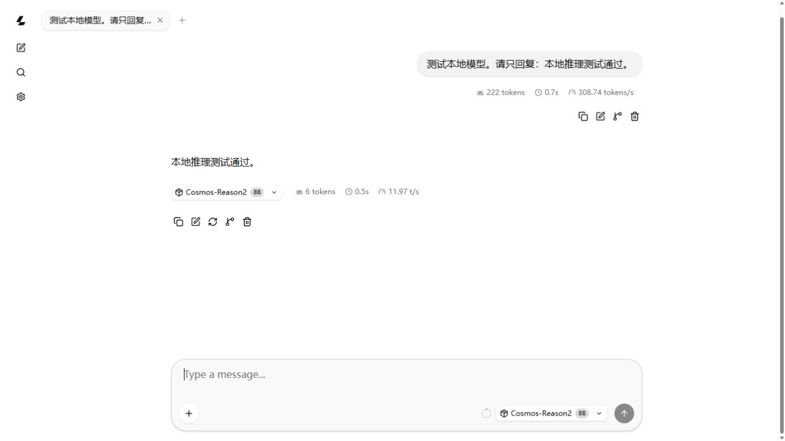
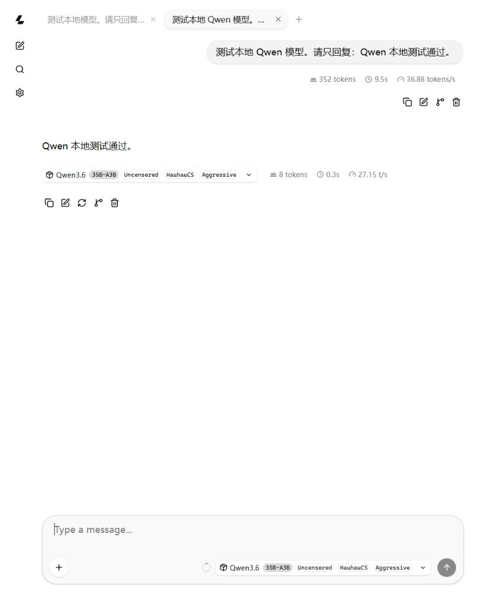

# 模型测试报告（持续更新）

> 记录建立：2026-10-21。按时间保留先前静态检查、隔离沙箱、router 与 Web UI 记录；文末新增独立端口的 API、图片和长输入复测。早期记录中的“当时未取得”不代表当前仍缺该证据。

## 已完成的只读检查

| 检查 | 实际结果 | 状态 |
| --- | --- | --- |
| `llama-server.exe --version` | `0.6.0-dev`，build 11461，commit `4d756bc72` | 本次实测通过 |
| PowerShell 启动器语法解析 | 原始 `llama-oneclick.ps1` 无解析错误 | 本次静态检查通过 |
| 本地端口 8080 | 隔离沙箱初查无监听；宿主机实际已有一个多模型 router 监听该端口 | 本次环境核验；沙箱与宿主机回环网络不同 |
| 模型文件存在性 | Qwen IQ2_M、Cosmos Q8_0 文件存在 | 本次静态检查通过；不代表推理通过 |
| 敏感信息模式扫描 | 对原始文本脚本和 INI 的有限模式扫描未命中 | 初筛；公开前仍需人工复核 |

## 2026-10-21 受控短测（先前记录）

本节是先前测试的文字与数值摘要；完整原始请求、响应和服务日志未纳入仓库。公开展示时以此说明已观察到的现象，完整可复核证据仍待补齐。

1. 显卡当时只剩约 537 MiB 空闲显存；宿主机还运行着用户原有的 router，因此未并行加载第二个 10.86 GiB 模型实例。
2. 在隔离沙箱中直接启动 Qwen IQ2_M：CPU 模式、2048 上下文、8 线程、单并发槽。服务日志报告 `model loaded` 并监听沙箱的 `127.0.0.1:8080`。沙箱网络限制使该服务无法作为宿主机 API 请求目标；随后已停止此进程。
3. 宿主机原有 router 的 `/health` 返回 `{"status":"ok"}`。切换前 `/v1/models` 显示 Cosmos 为 loaded、Qwen IQ2_M 为 unloaded。router 进程启动参数包含 `--ctx-size 16384`，但本轮没有长输入验证。
4. 经用户授权，向 router 指定 Qwen IQ2_M 发送两次 `/v1/chat/completions` 短请求。第一次输入 19 tokens、输出 32 tokens；第二次输入 22 tokens、输出 128 tokens。两次模型 ID 均为 Qwen IQ2_M，`finish_reason` 均为 `length`，输出 token 全用于思考，`message.content` 为空。状态：模型切换与 token 生成已验证；聊天接口可见短答未通过。
5. 同一授权下再向 `/v1/completions` 发送短请求：输入 10 tokens、输出 24 tokens，模型 ID 为 Qwen IQ2_M，`text` 非空，内容以 `not a question, but a statement` 为主并重复，`finish_reason` 为 `length`。状态：可见文本生成已验证；回答质量和聊天接口仍需复测。
6. 每次临时切换后均向 Cosmos 发送 1 token 的最小恢复请求。响应模型 ID 为 Cosmos，输入 9 tokens、输出 1 token。最终 `/v1/models` 显示 Cosmos 为 loaded、Qwen IQ2_M 为 unloaded，`/health` 仍为 `ok`。状态：原模型已恢复；这条最小请求不足以证明完整回答质量。

上述 API 输出仅摘录模型 ID、状态及 token 统计，没有收录本机路径或完整个人日志。router 的模型状态与短请求不能代替 GPU 卸载证明或 16K 压力测试。

## 2026-10-21 独立端口加载复核

用户提供 `D:\Program App\llama\start.bat` 作为可用入口。静态检查确认它调用同目录的 `llama-oneclick.ps1`；该 PowerShell 脚本可解析，但会重写 `launcher.ini`、生成预设，还可能整理模型文件或在缺少运行器时安装依赖。因此本次使用工作区的[无整理动作示例](../scripts/llama-oneclick.example.ps1)进行隔离短测，未运行原始入口。

| 项目 | 实际结果 |
| --- | --- |
| 模型与运行方式 | Qwen IQ2_M，CPU 模式（`-GpuLayers 0`），`-Ctx 2048`，`-Predict 64`，仅监听 `127.0.0.1:18080` |
| 服务日志 | 出现 `n_ctx_slot = 2048`、`model loaded`、`listening on http://127.0.0.1:18080`；[脱敏摘录](evidence/qwen-iq2m-load-2026-10-21.txt) |
| API 请求 | `/health`、`/v1/models` 和 `/v1/completions` 请求均被当前执行环境拒绝访问回环套接字；无响应结果可计入本次通过项 |
| 收尾 | 已向测试进程发送中断并见到清理日志；未发现残留的 `llama-server` 进程；原始 `start.bat`、`llama-oneclick.ps1`、`launcher.ini`、`presets.generated.ini` 的修改时间未变化 |

本次只证明模型可在上述 2048 上下文、CPU 模式下加载。它不证明 16K 配置、GPU 卸载或可见推理答复。

## 2026-10-21 宿主机 Cosmos 短文本实测

通过应用内浏览器访问宿主机现有服务，`http://127.0.0.1:8080/health` 显示 `{"status":"ok"}`。`/v1/models` 中 Cosmos-Reason2-8B.Q8_0 为 `loaded`，其启动参数含 `--ctx-size 16384`，模型元数据含 `n_ctx: 16384`。这些状态字段仅说明当前配置与加载，不是长输入压力测试。

在本机 `llama-ui` 选择已加载的 Cosmos-Reason2 8B，发送：

> 测试本地模型。请只回复：本地推理测试通过。

界面得到可见回复：

> 本地推理测试通过。



状态：Cosmos 基础短文本交互通过。截图记录的是单次很短的 UI 请求；未据此推断 Token/s、长期稳定性、多模态效果或 16K 长输入效果。命令沙箱仍不能访问宿主机回环套接字，因此本轮未取得对应的原始 HTTP POST 响应或完整服务日志。

## 2026-10-21 宿主机 Qwen IQ2_M 短文本实测

在本机 Web UI 的独立对话中选择 `Qwen3.6-35B-A3B-Uncensored-HauhauCS-Aggressive-IQ2_M`，界面显示模型加载完成。针对先前思考内容耗尽输出额度的情况，仅将该测试对话的 Reasoning 设为 Off，发送：

> 测试本地 Qwen 模型。请只回复：Qwen 本地测试通过。

界面得到可见回复：

> Qwen 本地测试通过。



之后在新对话重新选择 Cosmos，并将 UI 思考选项恢复为 Default；再次查看 `/v1/models`，Cosmos 为 `loaded`、Qwen IQ2_M 为 `unloaded`。这次测试证明 Qwen IQ2_M 可在关闭思考模式的 UI 对话中给出短答；默认思考模式、原始 HTTP POST 响应、长输入和稳定性仍待验证。

## 2026-10-21 独立端口 API、图片与长输入复测

停用原有 8080 服务后，直接使用本机已安装的 `llama-server.exe`，依次在 `127.0.0.1:18080` 启动 Cosmos Q8_0、Qwen IQ2_M。两次均设置 `--ctx-size 16384 --gpu-layers 0 --parallel 1 --threads 8 --predict 512 --no-webui`；Cosmos 加载对应 mmproj 并设 `--no-mmproj-offload --reasoning off`。Qwen 先以 `--reasoning on` 测试，随后停止并以 `--reasoning off` 重启。没有运行或修改原始 `start.bat`、`llama-oneclick.ps1` 和模型文件。服务结束后已中断并见到清理日志。

| 场景 | 本次实际结果 | 判断 |
| --- | --- | --- |
| 服务加载与状态 | 两模型分别报告 `model loaded`、`n_ctx_slot = 16384`；`/health` 为 `{"status":"ok"}`，`/v1/models` 的 `n_ctx = 16384` | CPU 模式加载与本机接口可用 |
| Cosmos 短文本 POST | 输入 19、输出 8 tokens，正文为 `Cosmos API 测试通过。`，`finish_reason = stop` | 通过 |
| Cosmos 图片 POST | mmproj 加载后，对[合成测试图](fixtures/geometry-layout.png)回答“左侧是蓝色正方形，右侧是红色圆形，下方是绿色三角形。”；输入 273、输出 18 tokens，`stop` | 一张简单图片的识别与方位回答通过；见[多模态审阅](../docs/cosmos-multimodal-audit.md) |
| Qwen 短文本 POST，思考开启 | 输入 21、输出 187 tokens，正文为 `Qwen API 测试通过。`，`stop` | 提高输出上限至 512 后短答通过；此前 32/128 上限不足 |
| Cosmos 约 14.8K token 合成输入 | 输入 14,855、输出 44 tokens；首尾标记均在正文，附加了未要求的解释；日志 `truncated = 0` | 信息找回通过，严格格式未通过 |
| Qwen 约 14.8K 合成输入，思考开启 | 输入 14,848、输出 512 tokens；正文为空、思考内容非空，`finish_reason = length`；日志 `truncated = 0` | 长输入被处理，可见答复未通过 |
| Qwen 相同长输入，思考关闭 | 输入 14,850、输出 9 tokens；正文精确为 `B3F7 L9S2`，`stop`；日志 `truncated = 0` | 首尾标记和格式通过 |

长输入采用重复 ` blue` 14,800 次并放置首尾标记，实际 token 数由 API `usage` 记录。其长度约为 16,384 的 90.6%，不能声称测到精确上限或复杂文档准确率。原始响应留在本机不跟踪的 `test-output/`，脱敏统计见[API 证据](evidence/local-api-2026-10-21.md)。GPU 卸载、视频、长时间稳定性和量化性能均未测。

## 2026-10-21 用户历史会话导出复核

用户补充的两份 `llama-export` JSONL 含八条带图片的 Cosmos 测试请求。每条记录关联了用户提示词、base64 图片附件、模型 ID `Cosmos-Reason2-8B.Q8_0` 与后续完整文字回复；物体定位场景有两条相同的助手回复。原件哈希、会话时间、实际图片哈希与逐项摘要见[脱敏导出核验](evidence/llama-export-audit-2026-10-21.md)。本次只读解析原件，没有重新运行这些八项推理。

实际时序图片顶部带有英文杯子动作标签，故此前仅凭裁剪参考图否定“杯子动作”依据的判断已更正；导出图片仍是静态拼图，回复给出的 0–5 秒时间戳没有可核对的时间轴。八项历史测试的其他错误与局限见[多模态审阅](../docs/cosmos-multimodal-audit.md)。会话导出不含服务端日志、GPU 卸载证据或正式人工评分。

## 后续场景状态

2026-10-21 后续按用户要求实际使用原始 `start.bat`，完整数据见[端到端复测](evidence/start-bat-e2e-2026-10-21.md)。这次结果更新了下表；上文的 CPU 测试和历史会话仍保留为当时的记录。两模型依次启动，分别完成可见短答、5 次顺序短请求、近 16K 索引记录检索；Cosmos 另完成合成图和三张历史静态图的新提示词复测。边界请求的 API 输入与输出合计达到 16,384 tokens，答案正确，但两者服务日志均为 `truncated = 1`，故不能声称无截断边界通过。两次退出时显存分别回落约 5.2 GiB 和 5.0 GiB，支持 GPU 使用，准确卸载层数未知。测试配置文件已恢复原哈希，模型目录清单无差异，原有 8080 服务未中断。

| 场景 | 前置条件与步骤 | 预期与需要保存的实际证据 | 状态 |
| --- | --- | --- | --- |
| GPU 卸载与显存表现 | 原始启动器两次按 `--fit on` 自动分配，比较各自退出前后的显存 | 两次约 5 GiB 显存回落；Cosmos 清理日志出现 `CUDA0 compute buffer` | GPU 使用有证据；准确卸载层数和最佳参数未取得 |
| 精确 16,384 token 边界及复杂文档 | 250 条可核对索引记录和重复填充，逐步接近上下文极限 | 两模型均在合计 16,384 tokens 答对三值，但 `truncated = 1` | 边界已触及；无截断边界及自然长文档质量未证实 |
| 多次运行与持续稳定性 | 两模型各 5 次顺序短请求 | 两组均 5/5 正确，`finish_reason=stop` | 短时重复调用通过；长时稳定性未测 |
| 原始启动器完整端到端复测 | 审阅、备份、依次运行两个模型、检查并恢复配置 | 两模型加载和 API 通过；模型目录无差异，改写的 INI 已恢复哈希 | 已完成本机复测；没有测试网页热切换 |
| Cosmos 历史静态图片复测 | 以三张[实际会话附件](evidence/llama-export-audit-2026-10-21.md)重发新的定向问题；视频跳过 | 苹果数量、颜色、不存在目标三项均符合图片；[对照审阅](../docs/cosmos-multimodal-audit.md)保留历史错误 | 三项定向检查通过；原题整组正式准确率不可据此计算 |

## 单次测试记录模板

```text
时间（时区）：
测试场景：
运行器版本与来源：
模型文件名、来源与许可：
启动命令（脱敏）：
上下文与输出参数：
GPU 卸载参数：
请求（脱敏）：
实际响应：
服务器日志摘录或截图路径：
状态：通过 / 失败 / 待验证
问题与复测：
```

测试输出应单独保存在不追踪的本机位置，选择性脱敏后再纳入仓库。不要提交完整个人日志、模型权重或请求中的私人数据。
